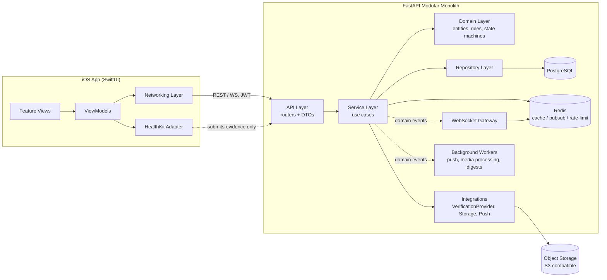
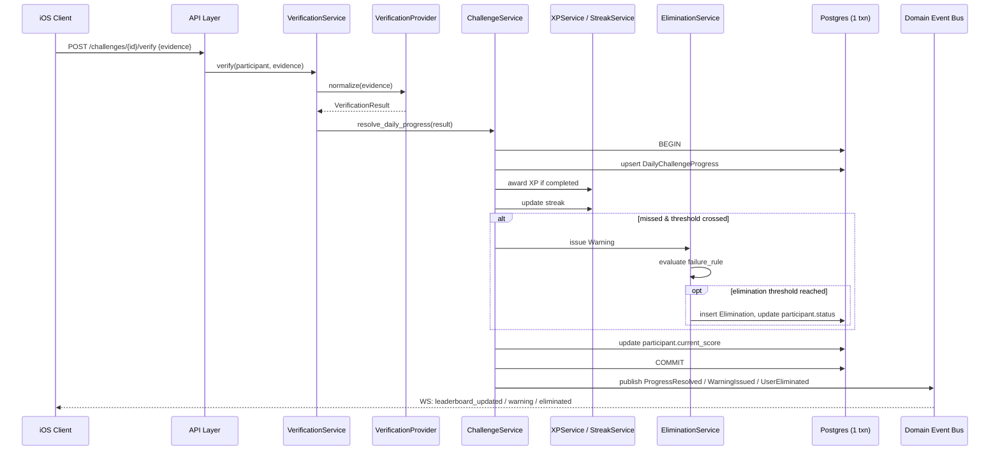
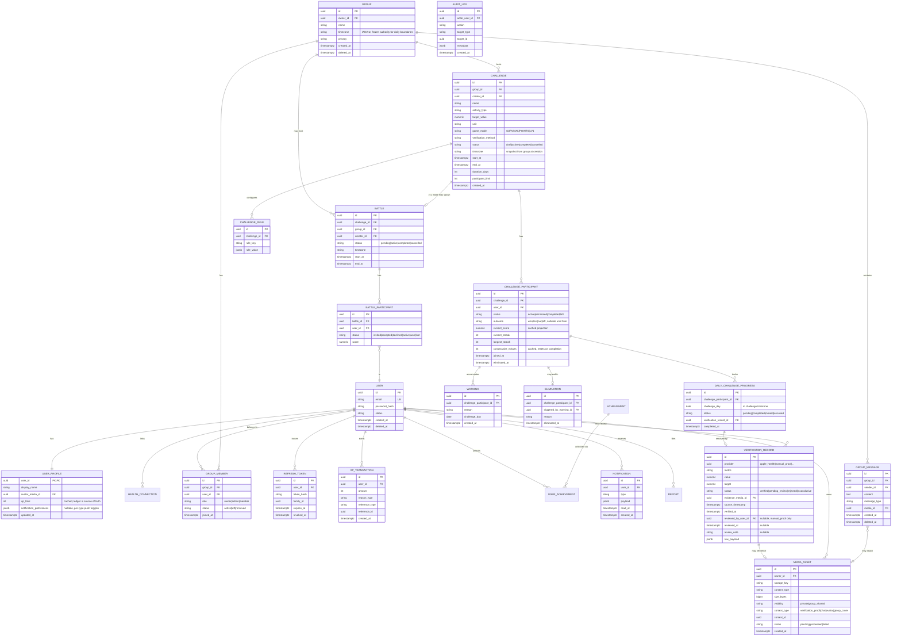

# FITWAR — Technical Architecture (V1)

Status: **Pre-implementation design.** Nothing below is code — it is the frozen shape that code will fill in. The existing UI prototype is the visual/product source of truth and is not altered by this document.

---

## 1. Architecture Overview

FITWAR V1 is a **modular monolith**, not microservices. One deployable FastAPI application, one PostgreSQL database, one Redis instance, one object storage bucket. Internally it is cut into strict domain modules with enforced boundaries, so that if a module ever needs to become its own service (e.g. `chat` or `media` under heavy load), the extraction is a deployment change, not a rewrite.

**Why modular monolith over microservices for V1:** the team is small, the domain is still moving (game modes, verification providers, and social features will change shape in the first two quarters), and cross-module transactions are common (completing a challenge touches participation, leaderboard, XP, and streaks atomically). Microservices would force distributed transactions or eventual consistency for logic that is naturally transactional today. A monolith with clean internal seams gets the same modularity benefit without the operational tax.

**Core architectural tenets:**

1. **Server is the source of truth for every derived/competitive value** — XP, rank, streak, elimination, deadlines, battle results. The client submits *evidence of an action*; the server decides *what happened*.
2. **Clean architecture layering**, one direction of dependency: `api → services → domain ← repositories`. Domain has zero framework/DB imports. Services orchestrate domain + repositories + integrations. API is a thin translation layer (HTTP ↔ DTOs).
3. **Verification is an abstraction**, not a HealthKit integration. Challenge completion logic never imports HealthKit; it consumes a normalized `VerificationResult` produced by a pluggable `VerificationProvider`.
4. **Everything competitive is transactional and idempotent.** Verifying a challenge, awarding XP, updating a streak, and possibly eliminating a player happen inside one DB transaction per event, keyed so retries (bad network, duplicate submission) can't double-award.
5. **Time is explicit, not implicit.** All storage is UTC; all "day" boundaries are computed server-side against a resolved, frozen timezone (see §11). No `datetime.now()` without a timezone context.
6. **Realtime is additive, not load-bearing.** REST + polling always works; WebSockets make it feel instant. Nothing is *only* reachable over the socket.



---

## 2. Repository Structure

```
fitwar/
├── backend/
│   ├── app/
│   │   ├── api/                    # HTTP layer only — routers, request/response wiring
│   │   │   └── v1/
│   │   │       ├── auth.py
│   │   │       ├── users.py
│   │   │       ├── groups.py
│   │   │       ├── challenges.py
│   │   │       ├── participation.py
│   │   │       ├── verification.py
│   │   │       ├── leaderboards.py
│   │   │       ├── battles.py
│   │   │       ├── chat.py
│   │   │       ├── media.py
│   │   │       ├── notifications.py
│   │   │       └── ws.py
│   │   ├── core/                   # config, security primitives, middleware, di container
│   │   │   ├── config.py
│   │   │   ├── security.py         # hashing, JWT encode/decode
│   │   │   ├── deps.py             # FastAPI Depends: current_user, group_member, rate_limit
│   │   │   ├── errors.py           # domain exception → problem-details mapping
│   │   │   ├── logging.py
│   │   │   └── events.py           # in-process domain event bus
│   │   ├── domain/                 # pure Python. No FastAPI, no SQLAlchemy imports.
│   │   │   ├── auth/
│   │   │   ├── users/
│   │   │   ├── groups/
│   │   │   ├── challenges/         # game mode rules, failure rules, state machine
│   │   │   ├── participation/
│   │   │   ├── verification/       # VerificationProvider protocol, VerificationResult
│   │   │   ├── leaderboards/
│   │   │   ├── xp/
│   │   │   ├── streaks/
│   │   │   ├── battles/
│   │   │   └── notifications/
│   │   ├── services/                # one file per use case, orchestrates domain+repo+integration
│   │   │   ├── auth_service.py
│   │   │   ├── group_service.py
│   │   │   ├── challenge_service.py
│   │   │   ├── verification_service.py
│   │   │   ├── leaderboard_service.py
│   │   │   ├── xp_service.py
│   │   │   ├── streak_service.py
│   │   │   ├── elimination_service.py
│   │   │   ├── battle_service.py
│   │   │   ├── chat_service.py
│   │   │   └── media_service.py
│   │   ├── repositories/            # SQLAlchemy-backed, one per aggregate root
│   │   ├── models/                  # SQLAlchemy ORM models (persistence shape)
│   │   ├── schemas/                 # Pydantic v2 DTOs (request/response), separate from ORM
│   │   ├── integrations/
│   │   │   ├── verification_providers/
│   │   │   │   ├── base.py          # VerificationProvider protocol
│   │   │   │   ├── apple_health.py
│   │   │   │   ├── manual_proof.py
│   │   │   │   └── camera_ai.py     # stub only, not implemented in V1
│   │   │   ├── storage/             # ObjectStorage protocol + S3 impl
│   │   │   └── push/                # APNs client
│   │   ├── workers/                 # background jobs: push fanout, media transcode, daily rollups
│   │   └── tests/
│   │       ├── unit/
│   │       ├── integration/
│   │       └── contract/            # shared test suite run against every VerificationProvider
│   ├── alembic/
│   ├── pyproject.toml               # ruff + mypy + pytest config
│   └── Dockerfile
│
├── frontend/
│   └── FITWAR/
│       ├── App/                     # entry point, DI container, app-level routing
│       ├── DesignSystem/            # colors, type (Archivo/JetBrains Mono tokens), components incl. generic Loading/Empty/NetworkError/Unauthorized/ServerError states (§20.10)
│       ├── Core/
│       │   ├── Networking/          # URLSession client, auth interceptor, endpoint definitions
│       │   ├── Persistence/         # Keychain wrapper, lightweight local cache
│       │   └── Health/              # HealthKit adapter — implements the same evidence contract as backend providers
│       ├── Features/
│       │   ├── Authentication/      # login, register, forgot/reset password
│       │   ├── Onboarding/
│       │   ├── Home/
│       │   ├── Challenges/          # list, detail, creation, completion
│       │   ├── Verification/        # health verification, video proof, manual-proof review queue (§20.5)
│       │   ├── Groups/              # groups list (§20.7), lobby, chat
│       │   ├── Battles/             # 1v1, victory, defeat (§20.11)
│       │   ├── Leaderboard/
│       │   ├── Warnings/            # warning, elimination, XP
│       │   ├── Settings/            # account, privacy, health, notifications, logout, delete (§20.9)
│       │   └── Profile/
│       └── FITWARTests/
│
├── docs/
│   ├── ARCHITECTURE.md              # this document
│   ├── api/                         # generated OpenAPI + human notes
│   └── adr/                         # architecture decision records, one file per frozen decision
│
└── infrastructure/
    ├── docker-compose.yml           # local: postgres, redis, minio, api
    ├── terraform/ (or equivalent)   # staging/prod: db, cache, storage bucket, secrets
    └── ci/
```

Module boundary rule enforced by convention (and a Ruff/import-linter check once the codebase exists): **`domain/` may not import `sqlalchemy`, `fastapi`, or any `integrations/*` package.** This is what keeps the "modular" in modular monolith — it's what would let `chat` or `media` be lifted into a separate service later without touching business logic.

---

## 3. Domain Model

### 3.1 Entities (final V1 list, normalized)

| Entity | Purpose |
|---|---|
| `User` | Identity + credentials. Nothing product-facing lives here. |
| `UserProfile` | Display name, avatar, bio, cached aggregates (xp_total), `notification_preferences` (nullable JSONB — per-type push toggles for the Settings screen, see §20.9). 1:1 with User, separated so identity and profile evolve independently. |
| `HealthConnection` | A user's link to an external verification source (Apple Health, later Health Connect/Garmin). Not tied to a specific challenge. |
| `Group` | A squad. Owns a timezone (see §11), privacy setting. **V1: every challenge is private/invite-only** — `privacy` is persisted and defaults to `invite`; a `public` value is accepted by the schema but has no discovery API in V1 (see §20.1). |
| `GroupMember` | Membership + role (owner/admin/member) + status (active/left/removed). A user may belong to multiple groups; there is no cap and no "primary group" concept (see §20.7). |
| `Challenge` | A fitness challenge inside a group. Owns game mode, verification method, failure rule, schedule. **Failure rule (warning/elimination) applies only to `SURVIVAL`-mode challenges** — `POINTS` and `1V1` run for their full duration and resolve by final score comparison; see §20.3. |
| `ChallengeRule` | Key/value rule config attached to a challenge (points formula, future configurable thresholds) — kept off the `Challenge` row so rules stay extensible per game mode without schema churn. V1's warning/elimination thresholds are fixed constants in `domain/challenges/failure_rule.py`, not `ChallengeRule` rows — see §20.4. |
| `ChallengeParticipant` | A user's membership in a specific challenge. Owns cached score/streak/status for fast leaderboard reads, plus `consecutive_misses` (mirrors `current_streak` in the opposite direction) and `outcome` (`WON \| LOST \| OUT \| LEFT`, set once the participant's fate is final — see §20.3). |
| `DailyChallengeProgress` | One row per participant per challenge-day. The atomic unit of "did they do it today." |
| `VerificationRecord` | The normalized result of a verification attempt, linked to a `DailyChallengeProgress`. Provider-agnostic. Manual-proof records additionally carry `reviewed_by_user_id`, `reviewed_at`, `review_note` once a reviewer acts — see §20.5. |
| `Warning` | A recorded miss that counts against a participant, per the challenge's failure rule. |
| `Elimination` | A terminal state transition for a participant, with the warning(s) that caused it. |
| `XPTransaction` | Append-only ledger entry. XP is never mutated in place, only added to via new rows. |
| `Achievement` / `UserAchievement` | Static catalog + unlock records. |
| `GroupMessage` | Group chat message, may reference shared media. |
| `MediaAsset` | Pointer to an object-storage object (video/image), with visibility and context. |
| `Battle` / `BattleParticipant` | 1v1 (V1) head-to-head, independently schedulable from a group challenge or embedded as a challenge's `1V1` game mode. |
| `Notification` | Persisted, user-facing notification feed entry (push is a side effect of this, not the record itself). |
| `RefreshToken` | Server-side record enabling rotation + revocation (see §6). |
| `AuditLog` | Immutable record of sensitive actions. |
| `Report` | Abuse/report hook — user-submitted, moderation-facing. |

Deliberately **removed/merged** from the prompt's starter list:
- `UserStreak` as a free-standing table → folded into `ChallengeParticipant` (`current_streak`, `longest_streak`) because a streak is meaningless outside the challenge it's measured against. A single "home screen streak" is a read-time aggregate across a user's active participants, not its own row.

### 3.2 Persisted vs. Calculated — and why

This is the highest-leverage design decision in the whole schema, so it's spelled out explicitly rather than left implicit in column choices.

| Value | Persisted? | Reasoning |
|---|---|---|
| **XP total per user** | Persisted *and* calculated. Source of truth is the `XPTransaction` ledger (append-only, auditable, replayable). `UserProfile.xp_total` is a cached projection, updated in the **same DB transaction** as the ledger insert. Never write to `xp_total` independently of a transaction row. | An in-place mutable counter with no ledger is unauditable and un-debuggable ("why does this user have 4,120 XP?"). A pure ledger with no cache makes every profile read an aggregate query. Both, kept in sync transactionally, gets correctness and speed. A nightly reconciliation job (`SUM(xp_transactions.amount)` vs `xp_total`) catches drift. |
| **Challenge participant score** | Persisted on `ChallengeParticipant.current_score`, source of truth is the sum/formula over that participant's `DailyChallengeProgress` rows. | Leaderboards are read far more often than progress is written; recomputing from scratch per read doesn't scale past a handful of participants. |
| **Leaderboard rank (the position number)** | **Never persisted.** Always computed at read time from cached scores (`ORDER BY current_score DESC`), optionally cached in Redis with a short TTL (5–10s) for hot challenges, invalidated on the domain events that change scores. | Rank is purely relative — persisting it means rewriting N rows every time anyone's score changes. It's cheap to compute and expensive to keep consistent if stored. |
| **Streak (current/longest)** | Persisted on `ChallengeParticipant`, updated by the same service transaction that resolves a day's `DailyChallengeProgress`. | Streaks gate UI (flame icon, XP multipliers) and are read constantly; recomputing by replaying every prior day's progress on every profile load is wasteful. It *is* fully reconstructable from `DailyChallengeProgress` if it ever drifts, which is what makes caching it safe. |
| **Elimination status** | Persisted as an explicit state transition (`Elimination` row + `ChallengeParticipant.status`), not inferred at read time. | Elimination is a **business decision**, not a pure function of warning count — it happens once, is time-stamped, may in future be reversible by an admin, and downstream systems (notifications, leaderboard freezing) need a concrete event to react to. It must, however, always be *reconstructable* from the warning history for audit purposes — if the persisted state and the replayed state ever disagree, that's a bug, not an acceptable source of truth divergence. |
| **Daily challenge day boundaries** | Never persisted as absolute timestamps per user. Computed server-side per §11 from `Challenge.timezone` + `Challenge.start_at`. | Storing "midnight for this user" as a literal timestamp bakes in a timezone decision that must instead be derived consistently, once, from the challenge's frozen timezone. |
| **Verification confidence/status** | Persisted on `VerificationRecord` at the moment the provider returns it. | It's an external fact about a specific attempt (HealthKit said X at time Y with confidence Z) — this is evidence, not a derived value, and must be immutable once written. |
| **`consecutive_misses`** | Persisted on `ChallengeParticipant`, same treatment as `current_streak` (§3.2 above) — a cached counter maintained by the same transaction that resolves a day, reset to 0 on completion, incremented on miss. | Failure-rule evaluation (§20.3/§20.4) needs this on every verify call; it's fully reconstructable by scanning the participant's recent `DailyChallengeProgress` rows, which is exactly what makes caching it safe. |
| **Challenge/battle `outcome` (`WON \| LOST \| OUT \| LEFT`)** | Persisted on `ChallengeParticipant`, written once and final: immediately for `OUT`/`LEFT` (elimination/leave are already terminal events), at challenge-close time for `WON`/`LOST`. | Same reasoning as Elimination: it's a decision event, not a pure function of current state, and Profile's Challenge History needs one column to read rather than re-deriving win/loss from rank-at-close on every request. Always reconstructable from final `status` + `current_score` + the tie-break rule (§20.3) if it ever needs auditing. |

### 3.3 Challenge State Machine

```
DRAFT → ACTIVE → COMPLETED
                → CANCELLED
```
`ChallengeParticipant.status`: `ACTIVE → ELIMINATED`, `ACTIVE → COMPLETED` (challenge ended, still standing), `ACTIVE → LEFT` (voluntary).

`ELIMINATED` is only reachable in `SURVIVAL`-mode challenges — `POINTS` and `1V1` have no failure rule and every participant reaches `COMPLETED` or `LEFT` (see §20.3–§20.4 for the full outcome and failure-rule decisions).

### 3.4 Verification → Progress → Elimination pipeline (the core business flow)



Everything from `BEGIN` to `COMMIT` is one transaction. If XP award or elimination check fails, the progress write rolls back too — there is no state where "completed" is recorded but XP wasn't granted.

**Idempotency:** `POST /challenges/{id}/verify` is keyed by `(challenge_participant_id, challenge_day)` — the unique constraint on `DailyChallengeProgress` makes a duplicate submission (retry after timeout, double-tap) a no-op or an explicit "already verified" response, never a double-award.

---

## 4. Database ERD



### 4.1 Key indexes and constraints

| Table | Index / constraint | Query it serves |
|---|---|---|
| `group_member` | UNIQUE(`group_id`,`user_id`); INDEX(`user_id`,`status`) | "my groups", membership check |
| `challenge` | INDEX(`group_id`,`status`) | "active challenges for this group" |
| `challenge_participant` | UNIQUE(`challenge_id`,`user_id`); INDEX(`user_id`,`status`) | "my active challenges", authorization checks |
| `daily_challenge_progress` | UNIQUE(`challenge_participant_id`,`challenge_day`); INDEX(`challenge_day`) | idempotent verify, "today's progress" |
| `xp_transaction` | INDEX(`user_id`,`created_at DESC`) | XP history |
| `group_message` | INDEX(`group_id`,`created_at DESC`) | chat pagination |
| `notification` | INDEX(`user_id`,`read_at`,`created_at DESC`) | notification feed / unread badge |
| `warning` | INDEX(`challenge_participant_id`,`created_at DESC`) | elimination-rule evaluation |
| `refresh_token` | INDEX(`family_id`); INDEX(`token_hash`) | rotation + reuse detection |
| `verification_record` | INDEX(`status`) | manual-proof review queue: joined from `verification_record → daily_challenge_progress → challenge_participant → challenge` filtered to `status='pending_review'` and the reviewer's group/creator scope. No denormalized `challenge_id` column added for V1 — the join is four tables but bounded by `status`, and V1 review-queue volume doesn't justify the extra write-path complexity of keeping a denormalized column in sync. |

**Soft-delete** applies to: `User`, `Group`, `GroupMessage`, `MediaAsset` (things users expect to "undo" or that have downstream references). **Hard-delete** applies to: `RefreshToken` (on rotation/expiry cleanup), expired `Notification`s (retention job). Everything competitive (`XPTransaction`, `Warning`, `Elimination`, `VerificationRecord`, `AuditLog`) is **immutable and never deleted** — they're the evidentiary record of "what happened," and disputes ("why was I eliminated") require them intact.

---

## 5. API Specification

Versioned under `/api/v1`. OpenAPI schema is generated directly from FastAPI — this list is the contract's shape, not the literal final route table.

| Domain | Endpoints |
|---|---|
| **Auth** | `POST /auth/register` · `POST /auth/login` · `POST /auth/refresh` · `POST /auth/logout` · `POST /auth/password-reset/request` · `POST /auth/password-reset/confirm` |
| **Me** | `GET /me` · `PATCH /me` (incl. `notification_preferences`) · `DELETE /me` · `GET/POST/DELETE /me/health-connections` · `GET /me/xp` · `GET /me/achievements` · `GET /me/challenge-history` |
| **Groups** | `GET /groups` (all groups the caller belongs to — the multi-group list, §20.7) · `POST /groups` · `GET /groups/{id}` · `PATCH /groups/{id}` · `POST /groups/{id}/join` · `POST /groups/{id}/leave` · `GET /groups/{id}/members` · `PATCH /groups/{id}/members/{user_id}` |
| **Chat** | `GET /groups/{id}/messages` · `POST /groups/{id}/messages` · `GET /groups/{id}/activity` |
| **Challenges** | `GET /challenges?scope=mine` (no `discover` scope in V1, §20.1) · `POST /groups/{id}/challenges` · `GET /challenges/{id}` · `PATCH /challenges/{id}` · `POST /challenges/{id}/join` · `POST /challenges/{id}/leave` · `GET /challenges/{id}/participants` |
| **Participation / Verification** | `GET /challenges/{id}/progress/today` · `GET /challenges/{id}/progress/{date}` · `POST /challenges/{id}/verify` · `GET /challenges/{id}/warnings` |
| **Verification Review** | `GET /challenges/{id}/proofs/pending` (creator/admin only) · `POST /verification-records/{id}/review` (§20.5) |
| **Leaderboards** | `GET /challenges/{id}/leaderboard` |
| **Battles** | `GET /battles` · `GET /battles/rivals` · `POST /battles` · `GET /battles/{id}` · `POST /battles/{id}/accept` · `POST /battles/{id}/decline` · `POST /battles/{id}/verify` |
| **Media** | `POST /media/upload-url` · `POST /media/{id}/complete` · `POST /media/{id}/share` · `GET /media/{id}` |
| **Notifications** | `GET /notifications` · `GET /notifications/unread-count` · `POST /notifications/{id}/read` — no dedicated inbox screen in V1 iOS, endpoints exist for the unread badge + future screen (§20.6) |
| **Reports** | `POST /reports` |
| **Realtime** | `WS /ws/groups/{id}` · `WS /ws/battles/{id}` |

Standard envelope conventions: cursor-based pagination (`?cursor=&limit=`) on all list endpoints; `GET .../verify` never exists — verification is a `POST` (it's an action with side effects, not idempotent-safe to name as GET even with caching); every mutating endpoint returns the updated resource, not just a status. Full detail (request/response shapes, error codes) lives in `docs/API_SPEC.md`.

---

## 6. Authentication Strategy

- **Password storage:** Argon2id (via `passlib`), not bcrypt — better resistance to GPU cracking, and it's the modern default for new systems.
- **Tokens:** short-lived **JWT access token** (15 min, stateless, signed HS256/RS256 — RS256 if we ever need another service to verify tokens without sharing the signing secret) + **opaque refresh token** (30 days, stored server-side as a **hash**, never the raw value).
- **Refresh rotation with reuse detection:** every `/auth/refresh` call issues a new refresh token and revokes the old one, linked by a `family_id`. If a revoked token is presented again (a stolen-token replay), the entire family is revoked and the user is forced to re-authenticate — this is the standard mitigation for refresh-token theft.
- **iOS storage:** refresh token in Keychain (`kSecAttrAccessibleAfterFirstUnlockThisDeviceOnly`); access token held in memory only, never persisted to disk.
- **OAuth-compatible:** the `User` table's credential shape allows adding `POST /auth/oauth/{provider}/callback` later (Sign in with Apple is the obvious V1.1 candidate given the App Store) without a schema migration — a nullable `password_hash` and a separate `auth_provider` column, decided but not built in V1.
- **Password reset:** `POST /auth/password-reset/request` issues a random opaque token, stored **hashed in Redis** with a short TTL (e.g. 30 min) and deleted on first use (single-use, no new Postgres table — reset tokens are ephemeral by nature, unlike refresh tokens which need durable revocation history). `POST /auth/password-reset/confirm` validates the token, sets a new `password_hash`, and revokes every existing refresh-token family for that user (a password reset is a full re-authentication event). Delivery is behind an `EmailSender` abstraction (mirrors `ObjectStorage`/`VerificationProvider`'s pattern) — the concrete provider (SES/Postmark/etc.) is a deployment-time config choice, not a Phase 1–7 blocker; local/dev logs the token instead of sending email.

---

## 7. Authorization Strategy

**Rule: never trust a client-supplied ID without an authorization check that hits the database.** Every endpoint that takes a `{resource_id}` in its path resolves it through a FastAPI dependency that both loads the resource *and* checks the caller's relationship to it, in one place, reused everywhere:

- `current_user` — decodes JWT, loads `User`, rejects if deleted/banned.
- `group_member(group_id)` — 403 if caller isn't an active member; returns their `GroupMember` (so role checks are cheap downstream).
- `group_admin(group_id)` — layers on top, 403 unless role is owner/admin.
- `challenge_participant(challenge_id)` — 403 if caller has no `ChallengeParticipant` row, or if group membership was revoked since joining.
- `challenge_reviewer(challenge_id)` — 403 unless caller is the challenge's `creator_id` OR an admin/owner of its group (§20.5, manual-proof review).
- `media_owner_or_shared(media_id)` — private proof media is only visible to its owner; group-shared media is visible to group members, and to a `challenge_reviewer` reviewing the specific submission it's attached to.

**Role model kept intentionally flat for V1:** group-level `owner / admin / member`. No per-challenge roles beyond "creator can edit pre-start, admin can moderate, participant can act on their own participation." Over-modeling permissions before the product needs them is exactly the kind of premature abstraction to avoid.

**Rate limiting:** Redis-backed sliding window, applied at the `core/deps.py` layer — tighter limits on `/auth/*` and `/challenges/{id}/verify` (abuse-prone) than on read endpoints.

**Upload validation:** enforced before a `MediaAsset` is marked `processed` — content-type allowlist (video/mp4, video/quicktime, image/jpeg, image/png), server-side size cap (e.g. 250MB for proof video, 10MB for images) checked against the actual uploaded object in storage (not just the client-declared `Content-Length`), and a background job that rejects files whose real content-type (via magic-byte sniffing) doesn't match what was declared.

**Account deletion:** soft-delete `User` immediately (login blocked, profile hidden), hard-purge PII (email, media, messages content) via a scheduled job after the account-recovery grace window (e.g. 30 days) — competitive records (`XPTransaction`, `Warning`, historical leaderboard entries) are anonymized (`user_id` retained for referential integrity, display name replaced) rather than deleted, so a departed player doesn't corrupt other players' historical leaderboards.

**Audit logging:** a dedicated `AuditLog` table (not just structured logs — logs rotate/expire, this table doesn't) written for: login, password change/reset, role change, group member removal, elimination overrides, media deletion, report resolution, account deletion, and **manual-proof review decisions** (approve/reject — §20.5).

---

## 8. Verification Abstraction

Challenge completion logic must never know whether "did the user hit 10,000 steps" came from HealthKit, a manually uploaded video, or (future) a GPS track. It only knows about a `VerificationResult`.

```
# domain/verification/base.py  — conceptual shape, not final code

class VerificationResult:
    verified: bool
    source: str                 # "apple_health" | "manual_proof" | "camera_ai" | ...
    metric: str                 # "steps" | "duration_minutes" | "distance_km" | ...
    value: float
    target: float
    timestamp: datetime         # when the activity occurred, not when it was submitted
    evidence_ref: str | None    # MediaAsset id, if any
    status: VerificationStatus  # VERIFIED | PENDING_REVIEW | REJECTED | INCONCLUSIVE

class VerificationProvider(Protocol):
    def submit(self, participant: ChallengeParticipant, evidence: RawEvidence) -> VerificationResult: ...
```

- `AppleHealthProvider` — receives HealthKit query results the iOS client already fetched and submitted (the *server* still decides pass/fail against the challenge target; the client is not trusted to self-report "I passed"). Confidence is `VERIFIED` if the sample's source/device is trusted and timestamp falls within the challenge day.
- `ManualProofProvider` — video/photo upload, `status = PENDING_REVIEW` until the challenge's creator/admin explicitly approves or rejects it (§20.5 has the full workflow and the deadline-driven resolution rule that keeps failure-rule timing deterministic regardless of how long review takes).
- `CameraAIProvider` (future, not built) — same interface, would just resolve `status` automatically instead of requiring human review. Not designed or scheduled for V1.

Provider selection is driven by `Challenge.verification_method`, resolved through a small registry (`{method: provider_instance}`) in the service layer — adding Health Connect, Garmin, or Fitbit later is "write a new provider that returns `VerificationResult`," not "touch `challenge_service.py`."

Every V1 test for this module runs a **shared contract test suite** (`tests/contract/`) against every provider implementation, so a provider that can't satisfy the interface fails CI immediately rather than surfacing as a runtime bug in challenge logic.

---

## 9. Media Architecture

Private verification proof and shareable group media are the same underlying object (`MediaAsset`) with different `visibility`, not two separate systems — a user can share a proof after the fact without re-uploading.

- **Storage:** S3-compatible object storage (AWS S3 in prod, MinIO locally) behind an `ObjectStorage` protocol — never store video/image bytes in Postgres.
- **Upload flow:** client requests `POST /media/upload-url` → server returns a **presigned PUT URL** + a `MediaAsset` row in `status=pending` → client uploads directly to storage → client calls `POST /media/{id}/complete` → server verifies the object exists, checks size/type, flips `status=processed` (or `failed`). This keeps large files off the API server entirely.
- **Visibility:** `private` (default for verification proof — only the owner and, for `manual_proof` challenges, group admins doing review can access via a short-lived signed GET URL) vs. `group_shared` (any active group member can access). Sharing is an explicit `POST /media/{id}/share` action, never automatic.
- **Context, not folders:** `context_type` + `context_id` (e.g. `verification_proof` + `daily_challenge_progress.id`, or `chat` + `group_message.id`) lets one asset be referenced from multiple places without duplicating storage.

---

## 10. Realtime Architecture

Realtime is used only where polling would visibly lag the product's "instant" feel — everything else stays plain REST.

| Event | Mechanism | Why |
|---|---|---|
| Chat message / reaction | WebSocket | Genuinely bidirectional, users expect sub-second delivery. |
| Battle status change (accepted, live progress, won) | WebSocket | Head-to-head tension is the point of the feature. |
| Leaderboard change, challenge completion, warning, elimination | WebSocket push **when connected**, REST is always the fallback source of truth on screen load | These are one-way server→client updates; a socket avoids a poll loop, but nothing depends on the socket for correctness. |
| Offline/backgrounded delivery of warning/elimination/message | APNs push, enqueued by a worker off the domain event bus | Sockets don't reach a backgrounded/killed app. |

**Design:** one WebSocket gateway process pattern, channels scoped to `group:{id}` and `battle:{id}`. On connect, the JWT is validated and channel subscription is authorized through the same `group_member`/`battle_participant` checks used by REST — a socket is not a way around authorization. Because the API may run multiple instances, socket fanout is backed by **Redis pub/sub**: a service commits a transaction, publishes a domain event, any instance holding a relevant socket relays it. This is the smallest realtime design that horizontally scales — no Kafka/dedicated streaming platform needed at V1 scale.

Domain events are also the trigger for the push-notification worker and for Redis-cached-leaderboard invalidation, so "realtime," "push," and "cache invalidation" are three subscribers to the same event, not three separate implementations.

---

## 11. Timezone Strategy

**Decision: a challenge's daily boundary is governed by the group's timezone, frozen onto the challenge at creation time.**

Concretely: `Group.timezone` is an IANA string (e.g. `Asia/Kolkata`), set when the group is created (defaulted from the creator's device timezone, editable by the owner). When a challenge is created, its `timezone` column is **snapshotted** from the group's current value and never changes again for that challenge, even if the group's timezone is edited later — an in-flight challenge must have a stable, non-retroactive daily boundary.

**Why group timezone, not creator or per-participant:**

- **Per-participant timezone is unfair and exploitable.** In a `SURVIVAL` challenge where a miss can eliminate you, giving a participant in `UTC-11` several extra hours to complete "today's" workout compared to a participant in `UTC+13` isn't a neutral technical choice — it's a competitive advantage tied to geography, and in a 1v1 or leaderboard context it's directly gameable (a participant could plausibly claim a timezone that maximizes their buffer).
- **Creator timezone is arbitrary and fragile.** The creator may leave the group; their timezone has no relationship to where the challenge actually happens if the group is geographically mixed. It also means two challenges in the same group could silently run on different daily clocks depending on who happened to create each one.
- **Group timezone is the right level of shared context.** A group is already the social/competitive unit everyone opted into: choosing to join a group implicitly means accepting its rhythm. It's stable (doesn't change per challenge), it's visible/settable by the group (owner picks it, ideally shown in the group settings UI), and every challenge in that group shares one predictable daily reset point — which is what "the leaderboard resets at midnight" needs to mean something consistent.

**Mechanics:**
- All timestamps stored in UTC (`timestamptz`), always.
- `DailyChallengeProgress.challenge_day` is a `date` computed server-side as `convert_timezone(now_utc, challenge.timezone).date()` — never computed client-side, never trusted from the client.
- DST transitions are handled for free by using IANA tz conversion (not fixed UTC offsets) — a 23- or 25-hour "day" during a DST transition is accepted as correct rather than special-cased.
- Battles inherit the same rule: a battle tied to a group uses that group's frozen timezone; a standalone 1v1 (no group) snapshots the creator's timezone at battle creation, same freeze-at-creation principle.

---

## 12. Error-Handling Strategy

- **Domain layer raises typed exceptions** (`NotFoundError`, `ForbiddenError`, `ConflictError`, `AlreadyVerifiedError`, `ChallengeNotActiveError`, `RateLimitedError`, ...) — it never knows about HTTP status codes, because the domain layer has no framework imports (§2).
- **API layer maps them** via a single FastAPI exception-handler registry to a consistent **Problem Details**-style JSON body:
  ```json
  { "type": "challenge_not_active", "title": "Challenge is not active", "status": 409,
    "detail": "Challenge 8f21... is in status 'completed' and no longer accepts verification.",
    "code": "CHALLENGE_NOT_ACTIVE" }
  ```
  `code` is the stable machine-readable field the iOS client switches on; `detail` is for logs/debugging, not guaranteed stable copy.
- **Validation errors** (Pydantic v2) are caught by a handler that reshapes FastAPI's default 422 body into the same envelope shape, so the client only ever parses one error format.
- **Idempotency over retries:** anything the client might legitimately retry (verify, join) is designed to be safely repeatable (§3.4) rather than requiring the client to avoid double-submission.
- **No silent catch-and-continue** on anything that touches XP/score/elimination — a failure in that transaction surfaces as a 5xx and rolls back completely; partial state (e.g., XP granted but streak not updated) is treated as a bug, not a degraded-but-acceptable outcome.

---

## 13. Logging Strategy

- **Structured JSON logs** (structlog), one line per event, never string-formatted prose — every line carries `request_id`, `user_id` (when authenticated), `route`, `latency_ms`, and event-specific fields.
- **Request correlation:** a middleware assigns/propagates `X-Request-ID`, present on every log line and echoed back in the response header, so a client-reported bug can be traced to exact server logs.
- **Audit logging is a separate concern from application logging** (§7) — logs are for operational debugging and expire/rotate; `AuditLog` rows are permanent, queryable business records for "who did what to whom," and are never satisfied by grepping logs.
- **No PII in log bodies** beyond `user_id` — emails, tokens, and media contents are never logged, even at debug level.
- Log level policy: `INFO` for request lifecycle and domain events (challenge completed, warning issued), `WARNING` for handled-but-notable (rate limit hit, verification rejected), `ERROR` only for unhandled exceptions / 5xx.

---

## 14. Testing Strategy

**Backend (pytest):**
- **Unit** (`tests/unit/`) — domain and service logic against **in-memory fake repositories**, no DB, no network. This is where game-mode rules, failure-rule evaluation, streak math, and the elimination state machine get their heaviest coverage, because they're pure logic and should run in milliseconds.
- **Integration** (`tests/integration/`) — repository layer against a real Postgres (docker-compose test DB, migrated fresh per test session via Alembic), verifying queries/constraints actually behave as designed (uniqueness, cascades, index-backed query plans for the hot paths in §4.1).
- **Contract** (`tests/contract/`) — one shared test suite run against every `VerificationProvider` implementation, so adding a provider that violates the interface fails immediately.
- **API** (`httpx.AsyncClient` against the FastAPI app) — auth flows, authorization boundaries (the 403 cases matter as much as the 200s), and the full verify→XP→streak→elimination pipeline end-to-end against a real test DB.
- Ruff (lint) + MyPy (typing, applied strictly to `domain/` and `services/`, more leniently at the API boundary where FastAPI's own typing does some of the work) run in CI on every PR.

**iOS (XCTest):**
- ViewModel unit tests against a protocol-mocked networking layer (no live network in unit tests).
- Snapshot tests for `DesignSystem` components (dark/light, both accent states) so the existing UI prototype's visual language doesn't drift silently.
- A thin set of integration tests against a local backend instance for the critical path (login → join challenge → submit verification → see leaderboard update), run less frequently (CI nightly or pre-release) than the fast unit suite.

---

## 15. Environment Configuration

- **`pydantic-settings`** `BaseSettings` subclasses per config domain (`DatabaseSettings`, `AuthSettings`, `StorageSettings`, `RedisSettings`), composed into one `Settings` object, **validated at process startup** — the app should fail to boot on a missing/malformed env var, not fail on the first request that needs it.
- **12-factor:** all config from environment variables. `.env.example` committed (documents every required key, no real values); `.env.local` for local dev (gitignored); staging/prod never read `.env` files — secrets are injected by the platform's secret manager (e.g. AWS Secrets Manager / SSM Parameter Store) directly into the process environment.
- **Per-environment isolation:** separate Postgres database, Redis instance, and storage bucket per environment (local/staging/prod) — no shared "staging happens to point at prod's bucket" shortcuts.
- **Feature flags:** V1 uses plain settings-driven booleans (e.g. `ENABLE_CAMERA_VERIFICATION=false`) — no external flag service. This is intentionally the simplest thing that works; revisit only if flag *targeting* (per-user/per-cohort) becomes a real need.

---

## 16. Local Development Instructions

```bash
# One-time
git clone <repo> && cd fitwar
cp backend/.env.example backend/.env.local

# Start infra: Postgres, Redis, MinIO (S3-compatible local storage), API (hot reload)
docker compose -f infrastructure/docker-compose.yml up -d

# Apply migrations
docker compose exec api alembic upgrade head

# Seed demo data (demo users, a group, an active challenge)
docker compose exec api python -m app.workers.seed

# Run backend tests
docker compose exec api pytest

# Lint / typecheck
docker compose exec api ruff check .
docker compose exec api mypy app
```

iOS: open `frontend/FITWAR.xcodeproj`, select the **Debug** scheme (its `.xcconfig` points `API_BASE_URL` at `http://localhost:8000`), run in Simulator. **Staging** and **Release** schemes point at deployed environments via their own `.xcconfig` files — the base URL is never hardcoded in Swift source.

---

## 17. Development Sequence

Build order follows the dependency graph of the domain, not the UI screen list — later phases are the ones that depend on earlier ones being real.

1. **Foundation** — repo scaffold, config, DB connection, Alembic baseline, auth (register/login/refresh), `User`/`UserProfile`, CI (lint+test).
2. **Groups** — `Group`/`GroupMember`, membership authorization dependency, group CRUD + join/leave.
3. **Challenges + Participation** — `Challenge`/`ChallengeRule`/`ChallengeParticipant`, `SURVIVAL` and `POINTS` game modes, join/leave, timezone-aware day-boundary logic (§11) built and tested in isolation before anything depends on it.
4. **Verification abstraction** — `VerificationProvider` protocol, `ManualProofProvider` first (simplest, no external dependency), `AppleHealthProvider` second once the iOS HealthKit adapter exists to feed it real evidence shapes.
5. **XP / Streaks / Leaderboard** — the transactional pipeline in §3.4, leaderboard read/cache.
6. **Warnings / Elimination** — failure-rule evaluation, elimination state machine, tied into the same pipeline.
7. **Media** — presigned upload flow, private-vs-shared visibility, wired into `ManualProofProvider`.
8. **Realtime + Notifications** — WebSocket gateway, domain event bus, push worker — deferred until there's enough real domain traffic (steps 3–6) worth broadcasting.
9. **Group chat** — mechanically simple once realtime exists; deliberately sequenced after competitive features because it depends on nothing else and nothing depends on it.
10. **Battles (1v1)** — reuses challenge/verification/XP machinery; sequenced after that machinery is proven rather than building it in parallel.
11. **iOS integration** — runs as its own parallel track from step 1 onward against the growing API (networking layer + Keychain auth first, then one feature module per backend phase), *not* a phase that starts after the backend is "done."

---

## 18. Technical Risks

| Risk | Why it matters | Mitigation direction |
|---|---|---|
| **HealthKit data latency/backfill** | A workout can sync into HealthKit minutes-to-hours after it happened; a naive "check right now" verification will produce false misses. | Verification window tolerance + allow a grace-period re-check rather than a single point-in-time query; server still enforces the true challenge-day boundary. |
| **DST / timezone edge cases** | A 23/25-hour challenge day, or a group changing timezone mid-challenge. | Frozen-at-creation timezone (§11) plus IANA-based conversion; explicit test cases for DST-transition days. |
| **Manual proof fraud** | Video/photo proof can be faked or reused. | `PENDING_REVIEW` status + peer/admin review workflow in V1; `Report` hook for flagging; `CameraAIProvider` is the designed-for future mitigation, not a V1 dependency. |
| **Double-submission / race conditions on verify** | Retry after timeout, flaky network, duplicate taps. | Idempotent transaction keyed on `(participant, challenge_day)` (§3.4). |
| **Concurrent leaderboard writes at scale** | Many participants completing near a deadline simultaneously. | Cached `current_score` updated per-row (not a full leaderboard recompute), rank computed at read time, short-TTL Redis cache absorbs read pressure. |
| **Video upload reliability on mobile networks** | Large proof videos on flaky connections. | Direct-to-storage presigned upload (not proxied through the API), resumable/chunked upload as a fast-follow if drop-off is observed. |
| **Manual-review latency vs. deadline** | A creator/admin who reviews slowly means most proofs resolve at the deadline as "missed" even when eventually approved (§20.5's deadline-driven resolution rule is deliberately non-retroactive for failure-rule purposes). | Push-notify reviewers promptly on new pending proofs; monitor time-to-review as a product metric post-launch — not a V1 blocker, but worth watching. |
| **WebSocket fanout at scale** | Multiple API instances, sockets need cross-instance delivery. | Redis pub/sub from day one (§10) even though V1 traffic doesn't need it yet — cheap to build in, expensive to retrofit. |
| **Push notification deliverability** | APNs token invalidation, backgrounded-app timing. | Notifications are persisted rows first (§3.1), push is a best-effort side effect — a missed push never means a missed notification in-app. |
| **Storage cost growth (video)** | Proof video volume grows with DAU/challenge count. | Lifecycle policy on private proof (e.g., auto-expire after a retention window unless shared) — a V1.1 decision, flagged now so it isn't a surprise. |

---

## 19. Decisions to Freeze Before Coding

These are the choices where changing course mid-implementation is expensive — they should be explicitly agreed (and written up as ADRs under `docs/adr/`) before the first line of application code:

1. **Challenge daily boundary = group timezone, frozen onto the challenge at creation** (§11). Changing this later means migrating every in-flight challenge's notion of "today."
2. **Server is the sole authority for XP, rank, streak, elimination, deadlines, and battle results** (stated up front, restated here because it's the one rule every future feature must respect). The client sends evidence, never outcomes.
3. **XP is an append-only ledger with a transactionally-synced cache**, not a mutable counter (§3.2).
4. **Verification is provider-abstracted from day one** — `challenge_service` must never import `HealthKit`/APNs/anything HealthKit-shaped directly (§8).
5. **Modular monolith, one deployable, enforced internal module boundaries** — no module gets its own database or gets called over the network internally in V1 (§1). Re-evaluate only if a specific module's load genuinely can't share the process.
6. **JWT access + rotating opaque refresh token with reuse detection** as the auth model (§6); refresh tokens live server-side, hashed.
7. **Media never touches Postgres** — object storage + `MediaAsset` pointer is non-negotiable from the first upload endpoint (§9).
8. **Realtime is additive** — every socket-delivered event must also be obtainable via REST; no feature may require a live connection to function correctly.
9. **Soft-delete for user-facing/undoable entities, immutable ledger for competitive/evidentiary ones** (§4.1) — decide the list once, don't special-case per table as they're built.
10. **API is versioned from `/api/v1` on day one**, even though there's only one client — breaking the contract later without a version bump is the expensive mistake this avoids.
11. **Domain layer has zero framework imports**, enforced by convention + lint rule, not just code review discipline (§2).
12. **Elimination is a persisted, timestamped decision, always independently reconstructable from warning history** — never purely inferred at read time (§3.2).
13. **No public/discoverable challenges in V1** — every challenge is reached via group membership (invite link or code); the schema stays extensible (`Group.privacy`) but no discovery endpoint is built (§20.1).
14. **No XP penalty for missed days** — a miss affects completion/streak/warning/elimination only, never the XP ledger (§20.2).
15. **Outcome (`WON/LOST/OUT/LEFT`) and the tie-break algorithm are fixed, documented rules**, not per-challenge configuration, applied uniformly wherever final scores are compared (§20.3).
16. **Failure rule is a fixed constant in V1** (miss 1 → warning, miss 2 **consecutive** → eliminated) and applies only to `SURVIVAL` mode; `ChallengeRule` remains the extension point for making it configurable later without a schema change (§20.4).
17. **Manual-proof review resolution is deadline-driven, not review-driven** — a day's failure-rule outcome is decided at the challenge-day deadline from whatever verification state exists then; a later approval still credits XP/streak/history but never retroactively reverses an already-issued warning or elimination (§20.5).
18. **No dedicated in-app notification inbox in V1** — the `Notification` entity, its API, and push delivery are all still built; only the standalone list screen is deferred (§20.6).

---

## 20. V1 Product Decisions — Design-Review Addendum

This section resolves every `UNKNOWN / REQUIRES DECISION` item raised in `docs/FITWAR_DESIGN_SPEC.md` §18 after reviewing the approved design against the Phase 0 architecture. Each subsection is a frozen decision (ADRs for the ones with lasting technical weight live under `docs/adr/`).

### 20.1 Public / Discoverable Challenges — NO in V1

Every challenge is reached through group membership — invite link or invite code, exactly as the design's `create4` (invite) screen shows. There is no `GET /challenges?scope=discover` endpoint and no public-challenge browsing surface in V1.

**Extensibility preserved, not built:** `Group.privacy` (`invite | public`) already exists in the frozen Phase 0 schema and remains as-is — a dormant field in V1, since nothing writes or reads it as `public` yet. If FITWAR adds public discovery later, the natural path is "a public `Group` that anyone can self-join," which needs zero schema migration — only a new `GET /groups?visibility=public` endpoint and its join flow. This resolved the one place the design plausibly conflicted with the frozen domain model (the DISCOVER tab's 1,204-player "CITY STEP LEAGUE") — no schema change was needed to resolve it. See `docs/adr/0001-no-public-challenge-discovery-v1.md`.

### 20.2 No XP Penalty for Missing — Confirmed

A missed day affects `DailyChallengeProgress.status`, `ChallengeParticipant.current_streak`/`consecutive_misses`, and the warning/elimination pipeline — **never** `XPTransaction`. The design's one XP-log example showing "Missed mission −40" was prototype mock data, not a confirmed product rule; it does not describe V1 behavior. `docs/FITWAR_DESIGN_SPEC.md` §9 is updated to remove it as a stated requirement. Rationale: keep V1's XP economy strictly additive while player behavior is unvalidated — see `docs/adr/0002-no-xp-penalty-for-missed-days.md`.

### 20.3 Outcome (WON / LOST / OUT / LEFT) and Tie-Break Rule

`ChallengeParticipant.outcome` is computed as follows:

| Game mode | WON | LOST | OUT | LEFT |
|---|---|---|---|---|
| `SURVIVAL` | Every participant who reaches challenge end without elimination (there can be multiple winners — it's a survival game, not a ranking game) | *(not used — see WON)* | Eliminated before challenge end (two consecutive misses) | Voluntarily left before the challenge ended |
| `POINTS` | Single participant with the highest final `current_score` among those who finished (tie-break below) | Every other participant who finished | *(not used — POINTS has no elimination, §20.4)* | Voluntarily left before the challenge ended |
| `1V1` (battle) | Higher final score (tie-break below) — mirrored onto both `BattleParticipant.status` and the linked `ChallengeParticipant.outcome` | Lower final score | *(not used)* | Declined/forfeited before completion |

**Tie-break rule (fixed, applies everywhere final scores are compared — POINTS ranking-at-close and 1V1 battle resolution alike):**
1. Highest final score wins.
2. If tied, whoever reached that final score **first** wins — the earlier `completed_at` timestamp of the `DailyChallengeProgress`/verification event that produced the final tally.
3. If still tied, the participant with the longer `current_streak` at the time of comparison wins.
4. If still tied, the participant who joined the challenge/battle earlier (`joined_at`) wins.
5. If still tied after all of the above (practically unreachable given timestamp precision), the participant with the lower `user_id` wins — a stable, arbitrary, fully deterministic final fallback so V1 never produces an unresolved draw.

This same rule also governs leaderboard rank ordering when scores tie, so "rank" and "outcome" never disagree about who's ahead. `outcome` is written once and is final (§3.2) — computed at elimination/leave time for `OUT`/`LEFT`, and at challenge-close time for `WON`/`LOST`. See `docs/adr/0003-challenge-outcome-and-tiebreak-rule.md`.

### 20.4 Failure Rule — Fixed Threshold, SURVIVAL-Only

Fixed for V1, not configurable: **miss 1 day → WARNING, miss 2 *consecutive* days → ELIMINATED.** "Consecutive" means completing a day resets `ChallengeParticipant.consecutive_misses` to 0 — a warning does not persist across an intervening completed day, matching the design's own copy exactly ("Complete today's mission to reset. Nobody's out yet.").

This rule applies **only to `SURVIVAL`-mode challenges.** `POINTS` mode has no elimination — the design's own mode description confirms this ("Everyone keeps playing. Highest total at the end takes the crown"). `1V1` battles resolve purely by final score comparison over their fixed duration, with no early-termination/strike mechanic — nothing in the design shows a battle-mid-flight elimination.

Extensibility is preserved without building it: the threshold values (`warning_threshold=1`, `elimination_threshold=2`) live as constants in `domain/challenges/failure_rule.py` for V1. `ChallengeRule` remains the extension point — making the threshold configurable later is "read from a `ChallengeRule` row instead of a constant," not a schema migration. No `ChallengeRule` rows are written for this in V1 (avoids unused rows for a fixed rule). See `docs/adr/0004-fixed-failure-rule-v1.md`.

### 20.5 Manual Video Proof Review Workflow

1. Participant records/uploads → `MediaAsset` (private) → `POST /challenges/{id}/verify` with `provider=manual_proof` → `VerificationRecord.status = PENDING_REVIEW`, `DailyChallengeProgress.status` stays `pending`.
2. Challenge creator or a group admin (the `challenge_reviewer` dependency, §7) sees it via `GET /challenges/{id}/proofs/pending` and calls `POST /verification-records/{id}/review` with `{ decision: APPROVE | REJECT, note? }`. This is an audited action (`AuditLog`, §7).
3. **APPROVE** → `VerificationRecord.status = VERIFIED`, `reviewed_by_user_id`/`reviewed_at` set → `DailyChallengeProgress.status = completed` → the same XP/streak/score transaction from §3.4 runs, triggered by the review action instead of the original submission.
4. **REJECT** → `VerificationRecord.status = REJECTED`, reviewer fields set. No XP/streak/score pipeline runs for this record.

**Deadline-driven resolution (the rule the review workflow needed, and the part that isn't obvious from the four steps above):** review is asynchronous and can happen before or after the challenge-day deadline passes. To keep failure-rule timing deterministic (Phase 0 §11's non-negotiable), a deadline-sweep resolves any day that has **no `VERIFIED` record at the moment the deadline passes** as `missed`, regardless of whether a `manual_proof` submission is still sitting in `PENDING_REVIEW` — the warning/elimination pipeline fires from that state, on schedule, never blocked on a human.

- A **rejection** therefore only has a visible effect when it happens *before* the deadline (it frees the participant to resubmit); a rejection after the deadline is a no-op for failure-rule purposes — the day was already `missed`.
- A **late approval** (after the deadline, after `missed`/warning already fired) still sets the day `completed`, still credits XP/streak/history for record-keeping, but **never retroactively reverses** an already-issued `Warning` or `Elimination` — consistent with Phase 0 §3.2's "Elimination is a persisted, timestamped decision," not something that un-happens based on a later async event.

Camera-AI auto-review remains explicitly future-only (`CameraAIProvider` stub, not implemented — §8). See `docs/adr/0005-manual-proof-review-workflow.md`.

### 20.6 Notification Inbox — No Dedicated Screen, Entity/API Kept

V1 iOS has no notification list screen. Delivery is APNs push + the existing group activity feed + a small unread-count badge (`GET /notifications/unread-count`, backing the SQUAD/HOME nav badge dot). The `Notification` entity, its persistence, and its full CRUD-ish API (`GET /notifications`, `POST /notifications/{id}/read`) are unchanged from Phase 0 — only the dedicated screen is deferred, so a future release can add one without any backend work. See `docs/adr/0006-no-notification-inbox-screen-v1.md`.

### 20.7 Multiple Groups — Confirmed, Simple List

V1 supports unlimited groups per user, exactly as the original Phase 0 schema already allowed (`GroupMember` has no cardinality cap). The only gap was iOS navigation: the design's SQUAD tab jumped straight to a single group with no list. Resolution: SQUAD now opens a simple, flat **Groups List** (new screen, backed by the already-existing `GET /groups` — no API change) — tapping a group enters the existing, unmodified Group screen (Roster/Feed/Chat tabs, unchanged). Zero groups shows the existing empty-state pattern with create/join CTAs. No group-switcher, no "primary group" concept, no redesign of the Group screen itself.

### 20.8 Login Screen — Added to Spec

A Login screen is added to `docs/FITWAR_DESIGN_SPEC.md` (email, password, "LOG IN" primary button, "Forgot password?" link, "Sign in with Apple" secondary button). No new backend endpoints beyond what Phase 0 already specified — `POST /auth/login` was already there. Two additions: `POST /auth/password-reset/*` (§20 auth section above) implements the "forgot password" flow rather than leaving it a dead link; Sign in with Apple remains architecture-compatible (`auth_provider` column, §6) but is **not implemented** in V1 — the button, if shown at all in the delivered screen, would need to be omitted or disabled until it's actually built, since shipping a non-functional button is worse than not designing one yet. Recommend the iOS Login screen ship without the Apple button in V1 and add it when the OAuth callback is actually built.

### 20.9 Settings Screen — Added, Kept Minimal

A single Settings screen is added to the design spec with six sections, all backed by endpoints that already exist or need no new surface: **Account** (display name/avatar via `PATCH /me`), **Privacy** (nothing new to store beyond what `MediaAsset.visibility` already governs per-item — V1 Settings' privacy section is informational/links to that behavior, not a new global toggle), **Health permissions** (`GET/DELETE /me/health-connections`), **Notification preferences** (`PATCH /me` with the new `notification_preferences` JSONB field), **Connected health source** (same `health-connections` endpoints), **Logout** (client-side token discard + `POST /auth/logout`), **Delete account** (`DELETE /me`, already specified). No new backend surface beyond the one new field.

### 20.10 Generic Loading / Error States — Design-Only Addition

Five reusable states added to the design spec's component library (§3), all styled from the existing `errPerm` template (icon swatch + headline + body + hint + actions): **Loading**, **Empty** (already existed, reused), **Network error**, **Unauthorized** (401 → force logout, redirect to Login), **Server error** (5xx, with Retry). These are iOS/DesignSystem components, not backend changes — the error contract they render from is exactly Phase 0 §12's Problem Details envelope.

### 20.11 1v1 Defeat — Added, Mirrors Victory

A Defeat screen is added to the design spec, structurally mirroring Victory (final scores, "BATTLE LOST" headline in place of "VICTORY," no XP-payout block since losers don't earn the win bonus, "Rematch" in place of "Challenge again," no "Post to group" share action). No backend change — `BattleParticipant.status = lost` already existed; this is purely the missing screen for the state that was always computable.

### 20.12 Dark + Light Mode — Confirmed Unchanged

Both palettes remain exactly as specified in the design's `[data-fw]`/`[data-fw="light"]` token blocks. No simplification to a single theme.

### 20.13 Final Verification Workflow (both paths, documented in full)

**Health-based challenge:**
`HealthKit query result (iOS)` → `AppleHealthProvider.submit()` → `VerificationResult` → `POST /challenges/{id}/verify` → backend validates against `Challenge.target_value` → `DailyChallengeProgress` resolves → XP transaction → streak update → `current_score` update → leaderboard cache invalidated → domain events published (`ProgressResolved`, possibly `WarningIssued`/`UserEliminated`) → WebSocket push to the group channel. This is exactly Phase 0 §3.4, unchanged.

**Manual exercise proof:**
`Video/photo capture (iOS)` → `POST /media/upload-url` → direct-to-storage upload → `POST /media/{id}/complete` → `MediaAsset.status = processed` → `POST /challenges/{id}/verify` with `provider=manual_proof` and the media reference → `ManualProofProvider` → `VerificationRecord.status = PENDING_REVIEW` (§20.5) → reviewer decision via `POST /verification-records/{id}/review` → **APPROVE** resumes the same `DailyChallengeProgress → XP → streak → score → leaderboard → domain events` pipeline as the health path; **REJECT** ends the pipeline with no further state change, subject to the deadline-driven resolution rule in §20.5.

---

**Stopping point.** This document is the frozen architectural shape for FITWAR V1. No application code has been written. The next step, once these decisions are confirmed, is Phase 1 of §17 — not a full build.
