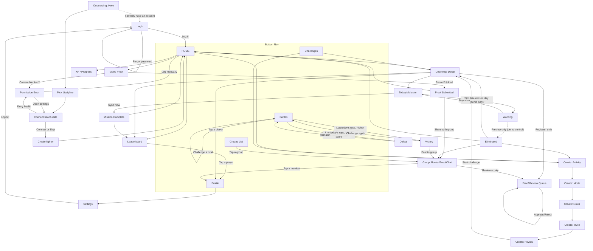

# FITWAR Design Specification

Source: `FITWAR.dc.html` (Claude Design interactive prototype, imported via "Send to Claude Code Web", read in full from `~/Downloads/FITWAR.dc.html`). This is the visual/UX source of truth. `ios-frame.jsx` and `support.js` were not delivered with the import; inspection of `FITWAR.dc.html` shows they are the design tool's own rendering plumbing (`IOSDevice` phone-chrome frame, and the `sc-if`/`sc-for`/`x-import`/`DCLogic` custom-element runtime) — generic to every Claude Design canvas, not FITWAR product content. All product screens, copy, and state live inline in `FITWAR.dc.html`'s own script block, so their absence does not leave a gap in this analysis.

**Note on the file's outer chrome:** lines 25–42 and 868–871 of the source (the "FIT WAR" wordmark header, DARK/LIGHT MODE + RESTART buttons, the row of flow-jump chips, and the footer caption) are the *prototype harness* — tools for browsing the demo — not FITWAR app screens. The actual app begins inside the `IOSDevice` frame.

---

## 1. Complete Screen Inventory

**Status: updated after the V1 product-decision review** (see `docs/ARCHITECTURE.md` §20). 25 screens are as designed in `FITWAR.dc.html`; 9 more are added per approved decisions, none of them redesigning an existing screen. New/changed rows are marked **[V1 ADD]** / **[V1 CHANGE]** below.

25 original screen states, driven by a single `screen` state string (`screenNames` array in the source).

| # | Key | Screen | Reachable from bottom nav? |
|---|---|---|---|
| 1 | `ob1` | Onboarding — Hero/Welcome | No |
| 2 | `ob2` | Onboarding — Pick discipline | No |
| 3 | `ob3` | Onboarding — Connect health data | No |
| 4 | `ob4` | Onboarding — Create fighter (profile) | No |
| 5 | `home` | Home / Dashboard | Yes — HOME |
| 6 | `challenges` | Challenges list (tabs: ACTIVE / DISCOVER / COMPLETED) | Yes — WARS |
| 7 | `detail` | Challenge Detail | No (drill-in from Home/Challenges) |
| 8 | `verify` | Today's Mission (live verification) | No (drill-in from Detail) |
| 9 | `complete` | Mission Complete | No (drill-in from Verify) |
| 10 | `proof` | Video Proof capture | No (drill-in from Home) |
| 11 | `proofDone` | Proof Submitted confirmation | No (drill-in from Proof) |
| 12 | `create1` | Create Challenge — pick activity | No |
| 13 | `create2` | Create Challenge — pick game mode | No |
| 14 | `create3` | Create Challenge — rules summary | No |
| 15 | `create4` | Create Challenge — invite squad | No |
| 16 | `create5` | Create Challenge — review & declare | No |
| 17 | `leaderboard` | Leaderboard (full, podium top-3) | Yes, as HOME sub-screen |
| 18 | `group` | Group/Squad (tabs: ROSTER / FEED / CHAT) | Yes — SQUAD |
| 19 | `battle` | Battles list (1 live + rivals to challenge) | Yes — BATTLES |
| 20 | `victory` | Battle Victory | No |
| 21 | `warning` | Warning (missed a day) | No |
| 22 | `eliminated` | Elimination | No |
| 23 | `xp` | XP / Progress / Level history | Yes, as HOME sub-screen |
| 24 | `profile` | Profile | Yes — YOU |
| 25 | `errPerm` | Permission error (camera or health, shared template) | No |
| 26 | `login` **[V1 ADD]** | Login — email, password, forgot password, log in | No |
| 27 | `groupsList` **[V1 ADD]** | Groups List — flat list of all groups the user belongs to (§20.7) | Yes — SQUAD now opens this first |
| 28 | `settings` **[V1 ADD]** | Settings — account, privacy, health permissions, notification prefs, connected health source, logout, delete account (§20.9) | No (from Profile) |
| 29 | `defeat` **[V1 ADD]** | Battle Defeat — mirrors Victory (§20.11) | No |
| 30 | `proofReview` **[V1 ADD]** | Manual Proof Review Queue — creator/admin approve/reject list (§20.5) | No (from Group/Challenge Detail, reviewer-only) |
| 31–34 | `loading` / `networkError` / `unauthorized` / `serverError` **[V1 ADD]** | Generic states, all styled from the existing `errPerm` template (§20.10) | No — overlays/replacements on any screen |

**Screen removed from scope:** the Challenges screen's **DISCOVER** tab is dropped — only **ACTIVE** and **COMPLETED** tabs ship in V1 (§20.1, no public challenge discovery). This is the one place an existing prototype screen changes, and it's a removal (fewer tabs), not a redesign.

**Bottom nav** (5 items, confirmed exactly as Phase 0 assumed): `HOME · WARS · BATTLES · SQUAD · YOU`. Nav is shown on 7 of the 25 screens (`home, challenges, battle, group, profile, leaderboard, xp`); `leaderboard` and `xp` highlight the HOME tab as their parent. All other screens are focused, nav-less task flows (onboarding, detail drill-ins, create flow, proof, victory, warning, elimination, permission error).

**Screens NOT present in the original design** (confirmed absent by inspection; resolution per §20 noted for each):
- No dedicated Notifications inbox/list screen — **decision: stays absent in V1** (§20.6), API kept for later.
- No Settings screen — **resolved: added** (§20.9, screen 28).
- No "my groups" / group-switcher screen — **resolved: added** (§20.7, screen 27, Groups List).
- No "Defeat" screen — **resolved: added** (§20.11, screen 29).
- No loading/skeleton states, no toast component, no modal/bottom-sheet pattern — **resolved: generic Loading/NetworkError/Unauthorized/ServerError states added** (§20.10, screens 31–34); toasts and modals remain genuinely out of scope, nothing in the approved decisions calls for them.
- No manual-proof reviewer UI — **resolved: added** (§20.5, screen 30, Proof Review Queue).
- No Login screen — **resolved: added** (§20.8, screen 26).

---

## 2. Navigation Flow

---

## 3. Component Hierarchy

**Chrome / navigation**
- Bottom tab bar — 5 flat icon-less buttons (dot indicator + JetBrains Mono label), active state = filled dot + full-opacity label
- Circular back button (`‹`), circular overflow button (`⋯`)
- Segmented tab control (pill group, e.g. ACTIVE/DISCOVER/COMPLETED, ROSTER/FEED/CHAT) — active segment fully filled with accent

**Headers**
- Eyebrow + headline pattern: small tracked-uppercase JetBrains Mono label above a bold Archivo headline. Used on nearly every screen (`STEP 1/3`, `TODAY'S MISSION`, `DAY 6/30 · MISS TWICE → ELIMINATED`, etc.)

**Cards**
- Challenge card (Home/Challenges list): title, meta line, status pill, big progress number, thin progress bar, rank
- Stat pair card (Profile stats grid, 2×2, hairline-divided cells)
- Achievement badge card (small, icon swatch + name)
- Leaderboard row (avatar, rank, name, sub-label, score; "me" row gets an accent border + tinted background, others are plain)
- Chat message bubble (mine = accent-filled right-aligned, theirs = surface-filled left-aligned with avatar + sender label, system = centered pill)
- Feed post card (proof video: thumbnail placeholder + duration chip, caption, reaction chips)

**Buttons**
- Primary: full-width, filled accent, 16px radius, bold uppercase-tracked label (the one recurring CTA style across the whole app)
- Secondary: same shape, outlined or `--srf2`-filled
- Ghost/text: transparent, dim color, no border
- Icon circle: 34px circular outline button (back/menu)
- Destructive variant: red-filled (only on "RECORD VIDEO")

**Progress / data viz**
- Linear bar, 4–10px, rounded, `--srf2` track + `--acc` fill, animated width transition
- Circular ring (SVG, stroke-dasharray/dashoffset, animated), used once — the Challenge Detail hero metric
- Split "vs" bar (Battle screen): two-color fill showing relative lead
- Podium (Leaderboard top-3): three columns of unequal-height bars, gold border on #1, accent border + "You" label if applicable

**Forms / selection**
- Grid select cards (2-column, icon swatch + label + meta) — discipline, activity, mode selection
- Row select buttons (fitness level, flat pill row)
- Underline text field (username, shown mid-entry with a blinking-cursor animation — no real keyboard/input element is modeled)
- Step progress indicator (Create flow): 5 thin segments, filled up to current step

**Avatars**
- Circular placeholder (single color, bordered) — no actual photo rendering modeled anywhere
- Avatar stack (overlapping circles, `-9px` overlap, `--bg`-colored border to punch through) — used for group member preview on Group header

**Feedback states**
- Empty state: icon swatch (dashed border) + headline + body + CTA (Challenges-COMPLETED empty, zero-groups Groups List)
- Permission error: icon swatch + headline + body + hint box + two actions (template reused for camera and health, switched by an `err` flag)
- Success/completion: large circular checkmark badge with pop-in animation (Mission Complete, Proof Submitted)
- **[V1 ADD] Generic states** (§20.10) — all built from the permission-error template's exact shape (icon swatch + headline + body + hint + actions), varying only copy/icon/actions: **Loading** (replace icon swatch with a spinner, no hint box), **Network error** (retry action replaces "open settings"), **Unauthorized** (single action: "Log in again", triggers logout), **Server error** (retry action). No new visual language introduced.
- **[V1 ADD] Review card** (§20.5) — one row per pending proof in the Review Queue: participant avatar+name, day label, video thumbnail (same placeholder treatment as existing proof-post cards), Approve (accent-filled) / Reject (outlined) button pair.
- **Not modeled, still out of scope:** toast/snackbar, modal or bottom-sheet overlay, inline form validation errors — nothing in the approved V1 decisions calls for these.

---

## 4. UI States

| State type | Where it appears | Notes |
|---|---|---|
| Empty | Challenges (DISCOVER/COMPLETED with no items) | Explicit illustration + CTA |
| Success/completion | Mission Complete, Proof Submitted, Victory | Pop-in checkmark or "VICTORY" headline |
| Warning (non-terminal) | Warning screen, orange system-chat messages, orange leaderboard sub-labels ("1 WARNING") | Orange accent throughout |
| Terminal/failure | Eliminated screen, red chat system message, dimmed+red leaderboard rows | Player remains visible in lists but visually de-emphasized (opacity, `--dim2` color) |
| Permission-denied | `errPerm` (camera/health) | Shared template, not two screens |
| Live/streaming | Verify screen (ticking counter + pulsing sync dot), Battle screen (pulsing LIVE dot) | `fwPulse` animation |
| Pending/awaiting review | Proof Submitted ("PENDING GROUP REVIEW") | **[V1 ADD]** Reviewer-side resolution now has a screen — Proof Review Queue (§20.5) |
| Loading | **[V1 ADD]** Generic Loading state (§20.10) | |
| Network error | **[V1 ADD]** Generic Network Error state, retry action (§20.10) | |
| Unauthorized (401) | **[V1 ADD]** Generic Unauthorized state — forces logout, returns to Login (§20.10) | |
| Server error (5xx) | **[V1 ADD]** Generic Server Error state, retry action (§20.10) | |

---

## 5. User Journeys

**A — First-time onboarding → first challenge**
Hero → pick discipline → connect health (or skip) → create fighter → Home. Home already shows an active challenge in this prototype (demo seed data), so the "join/create first challenge" moment isn't actually walked through by onboarding itself — it hands off straight to a populated Home.

**B — Daily verification loop (the core habit loop)**
Home (sees today's challenge card) → tap card → Challenge Detail (ring shows today's progress) → "OPEN TODAY'S MISSION" → Verify screen (live ticking count, "SYNC NOW") → Mission Complete (XP breakdown, rank change) → Leaderboard or Home.

**C — Manual/video-proof loop** (for non-auto-verified challenges, e.g. Push-up Survival)
Home card "SUBMIT PROOF" → Proof capture (record or upload) → Proof Submitted (private, "pending group review") → optional "SHARE WITH GROUP" → lands in Group Feed tab. **[V1 ADD, §20.5]** In parallel: the challenge creator or a group admin sees the submission in their Proof Review Queue → Approve (resumes the XP/streak/score pipeline, subject to the deadline-driven resolution rule) or Reject (no pipeline runs) → participant sees the eventual `completed`/`missed` outcome reflected in their next Detail/Home view (no separate "you were rejected" push in V1 — the daily-progress state itself carries the answer).

**D — Missed day → warning → elimination**
Warning screen (1 of 2 strikes, "nobody's out yet") → either recover via Verify, or (second miss) Eliminated screen → still-in-group affordances (watch battle / chat / join next challenge / home).

**E — Creating a challenge**
Challenges or Home "+ NEW" → 5-step wizard (activity → mode → rules summary → invite via join-code/link/WhatsApp → review) → Detail screen for the new challenge.

**F — 1v1 Battle**
Battles tab (one live battle shown + list of rivals with win/loss records) → "CHALLENGE" a rival, or log today's reps on the live one → Victory screen (XP payout, rematch or post-to-group).

**G — Social/group**
Squad tab → **[V1 CHANGE, §20.7]** Groups List (new) → tap a group → Roster (ranked member list with streak/warning/eliminated state) / Feed (proof posts + activity log) / Chat (bubbles, system messages, emoji reactions), unchanged from the original design.

**H — Login [V1 ADD, §20.8]**
Login screen (email, password) → "LOG IN" → Home. "Forgot password?" → request-reset (email) → user follows an emailed link/code → confirm-reset (new password) → back to Login. Onboarding's "I already have an account" now lands here instead of a dead link.

**I — Settings [V1 ADD, §20.9]**
Profile → Settings → Account (edit display name/avatar) / Health permissions (view/revoke HealthKit connection) / Notification preferences (per-type toggles) / Logout (returns to Login) / Delete account (confirms, then soft-deletes and logs out).

---

## 6. Data Required Per Screen

| Screen | Data needed |
|---|---|
| Home | user display name, level, XP total + XP-to-next-level, current global streak, up to N active challenge participant summaries (name, day/duration, player count, progress vs target, countdown, rank, verification-status), one "needs proof" challenge if any, user's rank + XP-gap to leader, recent friend activity feed |
| Challenges list | participant's challenges grouped by ACTIVE/DISCOVER/COMPLETED, each with progress %, rank, status pill |
| Challenge Detail | challenge name, mode, participant count, day X/Y, failure rule copy, today's metric value/target, countdown to day boundary, verification method label, top-N leaderboard preview |
| Verify | live metric value (from health provider or manual), target, remaining, countdown, last-synced timestamp |
| Mission Complete | final metric value, XP awarded (broken into components: completion + streak bonus), new level/XP total, old rank → new rank |
| Video Proof | challenge/day context, target reps/metric, camera/upload capability |
| Proof Submitted | clip duration, caption, review status |
| Create flow | activity catalog, available game modes (+ "coming soon" modes), default rule set per mode, generated join code, group roster with invite status |
| Leaderboard | full ranked participant list (rank, name, streak/status sub-label, score, delta), gap-to-leader |
| Group | member roster (name, state — streak/warning/eliminated —, rank), feed posts (shared proof + activity log), chat messages (sender, text, timestamp, reactions) |
| Battles | live battle (both participants' scores, day X/Y, time remaining), rival list with head-to-head records |
| Victory | final scores both sides, XP payout |
| Warning | which challenge, current progress, warning count / threshold |
| Eliminated | which challenge, day of elimination, reason, remaining player count |
| XP | level, XP total/to-next, current streak, chronological XP ledger (reason, amount, signed) |
| Profile | display name, level, streak, aggregate stats (challenges/wins/losses/win-rate), achievement badges, challenge history (name, date, outcome — now a real `WON/LOST/OUT/LEFT` value, §20.3) |
| **[V1 ADD]** Login | email, password fields; no server data needed to render |
| **[V1 ADD]** Groups List | all groups the user belongs to (name, member count, active-challenge count) |
| **[V1 ADD]** Settings | display name, avatar, health connections + status, notification preference flags |
| **[V1 ADD]** Defeat | final scores both sides (same data Victory already receives) |
| **[V1 ADD]** Proof Review Queue | pending `VerificationRecord`s for challenges the caller can review: participant, day, media reference, submitted-at |

---

## 7. API Requirements

See `docs/API_SPEC.md` for the full contract. Summary of what the design actually justifies beyond the Phase 0 sketch: verification needs both an automatic (health) and manual (video-proof, plus a review-decision endpoint, §20.5) submission path, already anticipated by Phase 0's `VerificationProvider` abstraction; group needs three read views (roster/feed/chat) that already map to existing Phase 0 entities; battles need a lightweight "who can I challenge" rival list that isn't in the original Phase 0 endpoint sketch. Challenge listing does **not** need a discoverability filter — resolved against, not for, per §20.1.

## 8. Authentication Requirements

**Resolved (§20.8).** Onboarding's `ob1` "I already have an account" ghost link now routes to a real Login screen (email, password, forgot-password flow, log in) — screen 26, journey H. Phase 0's auth strategy (JWT + refresh) is unmodified; password reset is now a real (if minimal) flow rather than a dead link, backed by `POST /auth/password-reset/request` and `/confirm`. Sign in with Apple stays architecture-compatible but is not built or shown in V1.

## 9. Gamification Requirements

Confirmed: numeric Level + XP bar (linear, per-level threshold), day-streak counter (flame icon + number), XP ledger with signed entries and named reasons (challenge completion, streak bonus, battle win, achievement unlock), achievement badges (icon + name only, no progress-toward-badge UI), profile aggregate win/loss/win-rate stats.

**Resolved (§20.2): no XP penalty for missing.** The prototype's XP-log mock data included one entry reading "Missed mission … −40" — this was demo filler, not a confirmed product rule, and the approved V1 decision is explicit: a missed day affects completion/streak/warning/elimination only, never the XP ledger. The XP History screen in the delivered app will not show negative entries for missed days.

## 10. Workout / Activity Requirements

Activity types shown: Steps, Distance/Running, Strength/Reps (push-ups, squats), Calories, Endurance/Duration, "General/mixed." These map directly to Phase 0's `Challenge.activity_type` + `unit` + `target_value` fields — no new entity needed.

## 11. Challenge Requirements

Confirms Phase 0 exactly: three V1 modes (SURVIVAL, POINTS, 1V1) with TOURNAMENT/TEAM BATTLE/BOSS BATTLE explicitly shown as "SOON" (disabled) chips — validates the "future-ready, not built" instruction. Confirms challenges are created inside a squad/group and populated via join-code, share-link, or a direct per-member invite list.

**Resolved (§20.4): fixed 2-strike failure rule, SURVIVAL-only.** Miss 1 day → WARNING, miss 2 *consecutive* days → ELIMINATED, not configurable in V1. Applies only to SURVIVAL-mode challenges — POINTS ("everyone keeps playing") and 1V1 (resolved by final score at battle end) have no elimination.

**Resolved (§20.1): the Challenges screen's DISCOVER tab is dropped.** No public challenge discovery in V1 — the delivered Challenges screen ships with ACTIVE and COMPLETED tabs only.

## 12. Leaderboard Requirements

Rank, score, streak/status sub-label, delta-from-previous-rank ("+412"), gap-to-leader summary line. Podium treatment for challenge-level top 3. Confirms Phase 0's decision that rank itself is never persisted — it's exactly the kind of value this UI re-sorts and re-renders on every score change. **Resolved (§20.3):** tied scores now resolve deterministically via the fixed tie-break rule (earliest to reach the score → longer streak → earlier join → lower user_id), so rank ordering is never ambiguous.

## 13. Social Requirements

Group chat (text + emoji-reaction chips + system-generated milestone messages), a group activity feed distinct from chat (proof-share posts + passive activity log), member roster with per-member competitive state visible to the whole group (streak, warning count, eliminated). 1v1 battle invitations from a rival list with head-to-head record. Confirms Phase 0's private-proof-vs-shared-media distinction exactly ("Verification and sharing are separate. Your clip stays private unless you post it.").

## 14. Notification Requirements

**Resolved (§20.6): no dedicated inbox screen in V1, by decision.** Warnings and eliminations are presented as full-screen interstitials, lighter-weight social events appear as passive system messages inside group chat, and APNs push covers backgrounded delivery — exactly the combination the design already implied. Phase 0's `Notification` entity, its persistence, and its API are kept unchanged (so a future release can add the inbox screen without backend work); a lightweight `GET /notifications/unread-count` is added to back an unread badge on the nav.

## 15. Database Entities Implied by the Design

No new tables beyond Phase 0's frozen list were required. The design validates every entity in Phase 0 §3.1/§4 (Challenge, ChallengeParticipant, DailyChallengeProgress, VerificationRecord, Warning, Elimination, XPTransaction, UserStreak-as-participant-field, Achievement/UserAchievement, GroupMessage, MediaAsset, Battle/BattleParticipant, Notification). Resolving the V1 product decisions added a small number of **columns** (no new tables) to existing entities — see `docs/ARCHITECTURE.md` §20 and its updated §3.1/§4: `ChallengeParticipant.outcome` + `.consecutive_misses`, `VerificationRecord.reviewed_by_user_id`/`.reviewed_at`/`.review_note`, `UserProfile.notification_preferences`. Challenge/battle **outcome** (WON/LOST/OUT/LEFT) is no longer an open question — §20.3 defines the exact rule per game mode and the tie-break algorithm.

## 16. Backend Responsibilities

Unchanged from Phase 0 §1 tenet: server computes and owns XP, rank, streak, elimination, deadlines, and battle results. **Resolved (§20.1):** the one scope question this raised — public/discoverable challenges — is decided (not built in V1), so the `challenges` service's authorization model needs no conditional branch for it.

## 17. iOS Responsibilities

- Reproduce the visual system exactly (see design tokens below) — colors, Archivo/JetBrains Mono pairing, the recurring "eyebrow label + headline" header pattern, the full-width pill primary button, and the specific corner-radius scale (6–8 / 12–16 / 18–22 / 99px). This applies equally to the 9 new V1-added screens (§1) — they reuse the existing component vocabulary, none introduce a new visual language.
- Client-side ticking display (countdown timer, live step counter animating toward a synced value) between server syncs — display-layer only, the authoritative deadline and value always come from the server per Phase 0 §11.
- Local light/dark theme switching (the design's `[data-fw]`/`[data-fw="light"]` token swap is a direct model for a SwiftUI `ColorScheme`-driven token set) — confirmed unchanged, §20.12.
- HealthKit read-only integration (steps/distance, workouts/calories — exactly the two categories shown on the health-connect screen, explicitly "nothing else").
- Camera capture + video library picker for proof (15-second cap shown in the UI copy).
- **[V1 ADD]** Keychain-backed session handling that reacts to a 401 by routing to the generic Unauthorized state and then Login (§20.10), not a silent failure.

## 18. Unknowns and Assumptions — Resolution Status

All 12 items originally raised here are resolved by the approved V1 product decisions in `docs/ARCHITECTURE.md` §20. Nothing below is still open; this table exists so the resolution of each original question stays traceable.

| # | Original question | Resolution |
|---|---|---|
| 1 | Public/discoverable challenges vs. the group-scoped domain model | **No public discovery in V1** — the DISCOVER tab is dropped; `Group.privacy` stays in the schema, dormant, for future extensibility. §20.1 |
| 2 | Missed-day XP penalty rule | **No XP penalty for misses**, ever — the −40 XP log example was prototype mock data, not a rule. §20.2 |
| 3 | Win/Loss/Out determination per game mode | **Fully defined per mode** (SURVIVAL: all non-eliminated finishers WON; POINTS: top scorer WON, rest LOST; 1V1: higher score WON) plus a deterministic 5-step tie-break. §20.3 |
| 4 | Failure-rule configurability | **Fixed in V1**: miss 1 → warning, miss 2 *consecutive* → eliminated; SURVIVAL-mode only; `ChallengeRule` remains the future extension point. §20.4 |
| 5 | Manual (non-video) proof entry hinted at in error-screen copy | **Not built** — V1 ships exactly the modeled video-proof path (record/upload → `PENDING_REVIEW` → admin approve/reject); the error-screen hint text describes a future capability, not a V1 requirement. |
| 6 | Whether a notifications list screen is needed | **No dedicated screen in V1** — push + existing group activity feed + a lightweight unread-count badge cover it; the `Notification` entity/API stay fully built for a future screen. §20.6 |
| 7 | Multi-group iOS navigation | **Supported** — a new, simple Groups List screen (no complex switcher). §20.7 |
| 8 | Login screen design | **Designed and added** — screen 26. §20.8 |
| 9 | Settings/account management | **Designed and added, kept minimal** — screen 28, six sections, no new backend surface. §20.9 |
| 10 | Loading/generic error states | **Designed and added** — four states (Loading, Network error, Unauthorized, Server error), all reusing the existing permission-error template's shape. §20.10 |
| 11 | Battle defeat treatment | **Designed and added** — screen 29, mirrors Victory. §20.11 |
| 12 | Dark/light dual-theme requirement (confirmation, not a gap) | **Confirmed unchanged** — both palettes remain exactly as specified. §20.12 |

No unresolved product-level unknowns remain that affect the Phase 1–7 implementation sequence.
